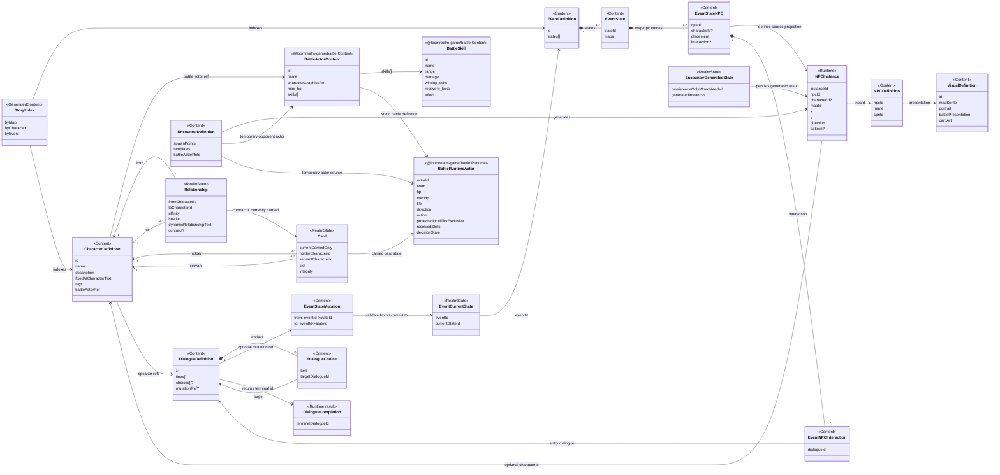
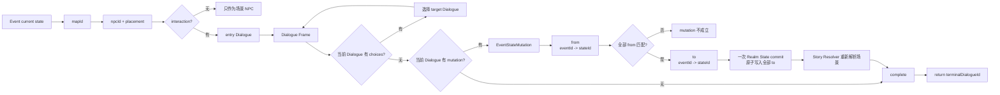
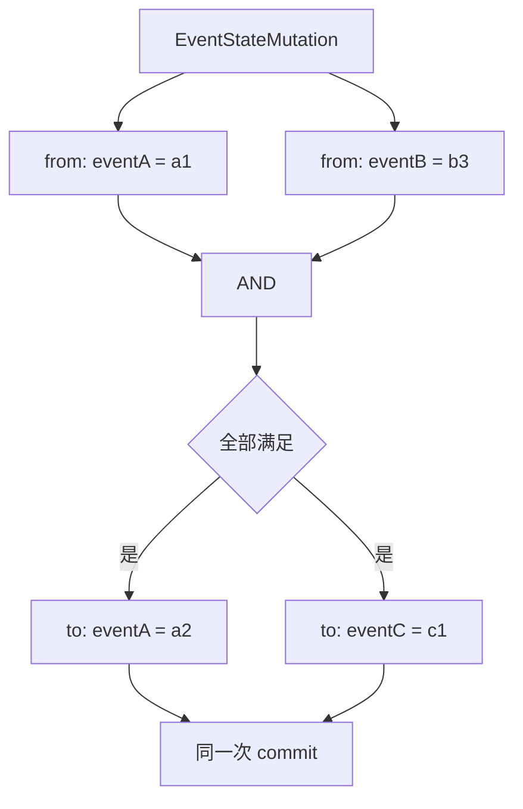
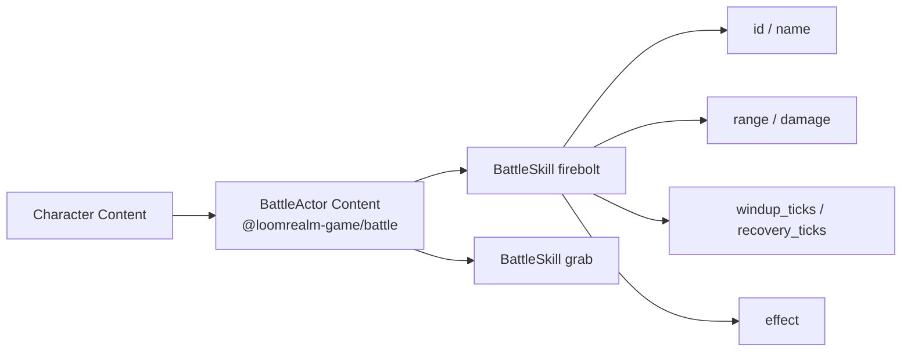

# 数据模型图

> 当前技术数据模型的可视化总览。只画已经确认到当前阶段的职责边界；带“未冻结”的部分不在图里假装成最终 schema。

## UML 总览



## Event State / NPC / Dialogue / Mutation 链路



关键边界：

```text
Event State
= 当前剧情阶段

Event State NPC
= 这个阶段 NPC 在哪、入口 Dialogue 是什么

Dialogue Choice
= 只选择下一段 Dialogue

无 Choice Dialogue
= 可以在完成时引用一个 EventStateMutation

EventStateMutation
= from: 多个 Event state 前置条件（全部 AND）
+ to: 多个 Event state 原子赋值
```

`choices` 与 `mutation` 互斥：

```text
choices 存在
=> mutation 不允许存在

mutation 存在
=> choices 不允许存在
```

所以如果某个 Choice 分支需要剧情状态变化：

```text
Choice
→ target Dialogue
→ target Dialogue 无 choices
→ target Dialogue.mutation
→ EventStateMutation
```

Event State NPC interaction 不再保存 `terminalDialogueId → Mutation` 映射，只保存入口 `dialogueId`。

## Mutation 的多 Event 语义



例如：

```text
from
  professor-intro = waiting
  rival-story = before-contract

AND 全部满足后

to
  professor-intro = contracted
  rival-story = contracted
  tutorial-battle = ready
```

Mutation 是“一组前置状态 → 一组状态赋值”，不是一组必须一一配对的 `A → B` 边。

需要 OR 时不在 Mutation 内增加 `or / anyOf`，而是为每个分支定义独立 Mutation，并由对应 Dialogue / 业务分支引用对应 Mutation。

EventStateMutation 只拥有 Event current state，不修改 Relationship / Contract / Card / Battle / player position 等其他 Realm State。

Runtime 也不会扫描全部 Mutation 自动执行。必须由明确的 Dialogue completion 或其他业务结果引用 Mutation。

## NPC / Event / Map 唯一性

```mermaid
flowchart LR
    EA[Event A current state] --> R[Story Resolver]
    EB[Event B current state] --> R
    CC[Character defaults] --> R
    EN[Encounter generated NPCs] --> R

    R --> V{validate final Map}
    V -->|每个 mapId 内 npcId 唯一| OK[NPCPlacement[]]
    V -->|同一 mapId 重复 npcId| ERR[deterministic conflict]
```

当前规则：

```text
Source Content
- 不同 Event 可以引用同一个 npcId
- 同一个 Event state 可以让同一个 npcId 出现在多个不同 Map

Final resolved Map
- (mapId, npcId) 必须唯一
```

`instanceId` 继续满足 `@loomrealm-game/map` 的实例 contract，但不能用不同 `instanceId` 绕过 PokeMan 的同图 `npcId` 唯一约束。

## Character / BattleSkill 链路



PokeMan 不再增加一层 `PokeManSkill`。BattleSkill 的 shape 和战斗语义由 `@loomrealm-game/battle` 维护；Character 只负责稳定关联 BattleActor Content。

## Relationship / Card / Battle 的关键链路

```mermaid
flowchart LR
    A[Character A] --> R[Relationship A → B]
    B[Character B] --> R

    R -->|contract = false| N[没有正式契约]
    R -->|contract = true| C{B 当前是否随 A 携带?}

    C -->|否| NC[没有当前 Card 对象]
    C -->|是| CARD[Card<br/>holder=A<br/>servant=B<br/>slot<br/>integrity]

    B --> BAC[BattleActor Content<br/>max_hp + skills[]]
    BAC --> SK[BattleSkill Content]
    CARD --> BRA[Battle Runtime Actor]
    BAC --> BRA

    BRA --> BR[Battle Simulation<br/>hp / tile / direction<br/>action / protection / Decision]

    S[Story / Encounter Battle Source] --> TBA[Temporary Battle Runtime Actor]
    BAC --> TBA
    TBA --> BR
```

## 当前最重要的边界

```text
Relationship
= 长期人与人关系
= affinity / hostile / dynamic text / contract

Card
= 当前随身 Card
= holder / servant / slot / 当前 Card battle-facing state

Dialogue
= lines + choices? + mutation?
= choices 与 mutation 互斥

EventStateMutation
= 只读写 Event current state
= from 全 AND，to 原子写入

BattleActor / BattleSkill Content
= @loomrealm-game/battle 的静态战斗定义

Battle Runtime Actor
= @loomrealm-game/battle 本场 Simulation actor
```

因此：

```text
contract exists
≠ Card 一定存在

Card exists
=> 对应 contract 已成立，并且当前进入随身编队

Battle Runtime Actor exists
≠ 必须来自 Card

PokeMan Skill
= 不单独存在
= 直接使用 BattleSkill
```

## 图中故意没有解决的问题

以下仍然留白：

- Card 是否需要独立 `cardId`；
- 从者有 contract 但不随身时，Integrity / Progression 长期状态最终由谁拥有；
- Character → BattleActor Content 的最终引用编码；
- 技能学习 / 成长如何改变某个角色长期可用的 `skills[]`；
- Event / EventStateMutation 的最终 Content namespace / key；
- 非 Dialogue 业务如何引用 Mutation；
- Dialogue mutation `from` 校验失败时的产品错误表现；
- 跨 Event 的同一 `(mapId, npcId)` 冲突未来是否需要显式 override；
- `absent` 与其他 Event 出现定义同时命中时的解析；
- Encounter re-entry 与生成结果持久化细节。

BattleSkill 本身的静态字段和执行语义不再作为 PokeMan 自己的未决 schema；它直接跟随 `@loomrealm-game/battle` 当前规范。
