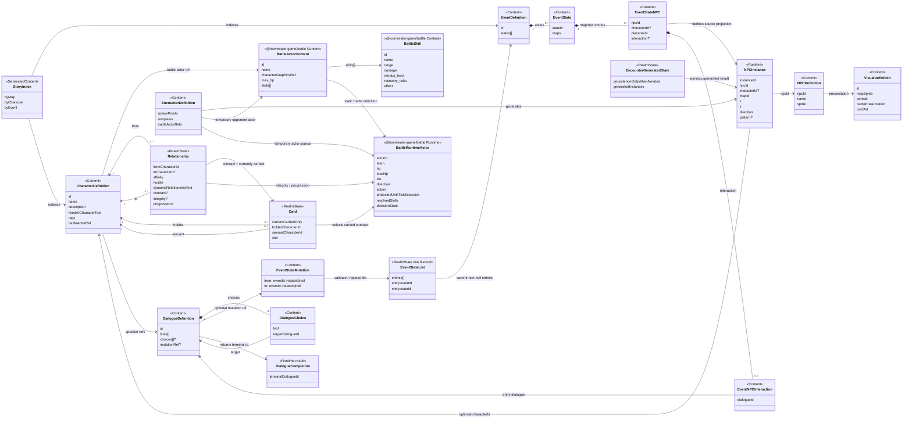
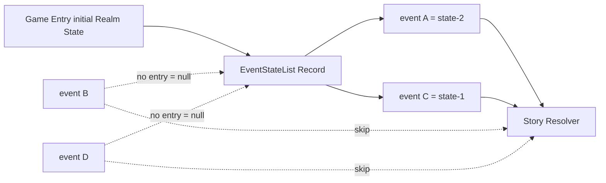
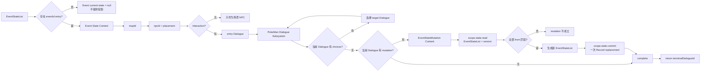
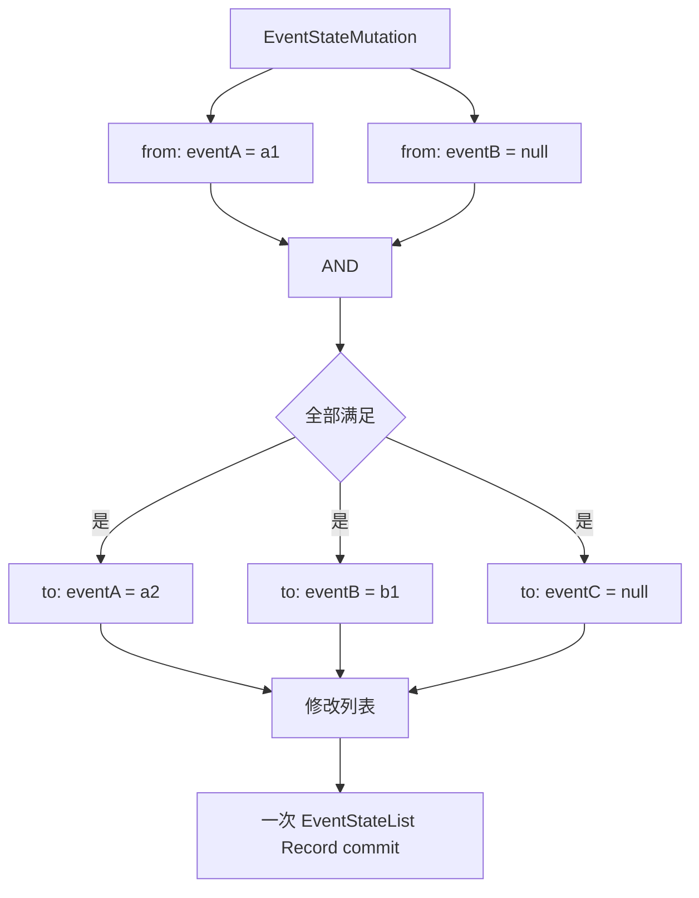
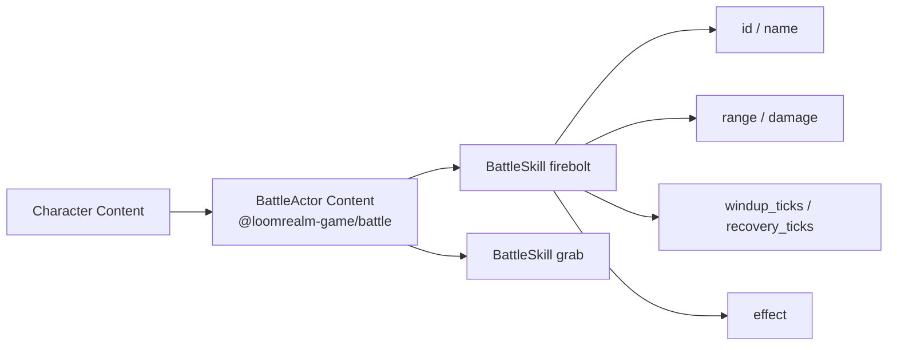

# 数据模型图

> 当前技术数据模型的可视化总览。只画已经确认到当前阶段的职责边界；带“未冻结”的部分不在图里假装成最终 schema。

## UML 总览



## EventStateList：一个 Realm State Record



当前物理模型已经确定：

```text
EventStateList
[
  { eventId, stateId },
  ...
]
```

规则：

```text
有 entry
→ current state = entry.stateId

无 entry
→ current state = null
→ Event 当前未启动 / 已清空
```

列表只保存非空 state；不保存 `stateId: null` 项。

```text
null → stateId
= 新增 entry / 启动 Event

stateId → stateId
= 修改 entry / 推进 Event

stateId → null
= 删除 entry / 清空 Event
```

EventStateList 的最终 Realm State namespace / key 名字仍未冻结，但“一张列表 Record”已经冻结。

## Event State / NPC / Dialogue / Mutation 链路



关键边界：

```text
Dialogue Content
= 数据

EventStateMutation Content
= 数据

PokeMan Dialogue Subsystem
= executor
= 解释 Dialogue graph / Mutation
= 通过 scope.state commit EventStateList

@loomrealm-game/rpg-dialogue
= Conversation interaction / presentation
```

`choices` 与 `mutation` 互斥：

```text
choices 存在
=> mutation 不允许存在

mutation 存在
=> choices 不允许存在
```

所以如果某个 Choice 分支需要剧情状态变化：

```text
Choice
→ target Dialogue
→ target Dialogue 无 choices
→ target Dialogue.mutation
→ PokeMan Dialogue Subsystem 执行 EventStateMutation
```

Event State NPC interaction 只保存入口 `dialogueId`。

## Mutation 的多 Event / 空状态语义



例如：

```text
from
  professor-intro = waiting
  rival-story = null

AND 全部满足后

to
  professor-intro = contracted
  rival-story = contracted
  tutorial-battle = ready
```

`from: null` 表示当前列表没有该 Event entry。

`to` 的解释：

```text
to = stateId
→ upsert EventStateList entry

to = null
→ 删除 EventStateList entry
```

Mutation 是“一组 Event state/null 前置条件 → 一组列表变更”，不是一组必须一一配对的 `A → B` 边。

需要 OR 时不在 Mutation 内增加 `or / anyOf`，而是为每个分支定义独立 Mutation，并由对应业务分支引用对应 Mutation。

EventStateMutation 只拥有 Event current state，不修改 Relationship / Contract / Card / Battle / player position 等其他 Realm State。

Runtime 也不会扫描全部 Mutation 自动执行。必须由明确业务路径中的 PokeMan Subsystem 读取并执行 Mutation。

## NPC / Event / Map 唯一性

```mermaid
flowchart LR
    L[EventStateList] --> R[Story Resolver]
    CC[Character defaults] --> R
    EN[Encounter generated NPCs] --> R

    R --> V{validate final Map}
    V -->|每个 mapId 内 npcId 唯一| OK[NPCPlacement[]]
    V -->|同一 mapId 重复 npcId| ERR[deterministic conflict]
```

当前规则：

```text
Source Content
- 不同 Event 可以引用同一个 npcId
- 同一个 Event state 可以让同一个 npcId 出现在多个不同 Map

EventStateList
- 只有有 entry 的 Event 参与投影

Final resolved Map
- (mapId, npcId) 必须唯一
```

`instanceId` 继续满足 `@loomrealm-game/map` 的实例 contract，但不能用不同 `instanceId` 绕过 PokeMan 的同图 `npcId` 唯一约束。

## Character / BattleSkill 链路



PokeMan 不增加一层 `PokeManSkill`。BattleSkill 的 shape 和战斗语义由 `@loomrealm-game/battle` 维护；Character 只负责稳定关联 BattleActor Content。

## Relationship / Card / Battle 的关键链路

```mermaid
flowchart LR
    A[Character A] --> R[Relationship A → B]
    B[Character B] --> R

    R --> RS[contract<br/>affinity / hostile<br/>integrity / progression]
    RS --> C{B 当前是否随 A 携带?}

    C -->|否| NC[没有当前 Card<br/>Relationship 长期状态仍存在]
    C -->|是| CARD[Card<br/>holder=A<br/>servant=B<br/>slot]

    B --> BAC[BattleActor Content<br/>max_hp + skills[]]
    BAC --> SK[BattleSkill Content]

    CARD --> BRA[Battle Runtime Actor]
    R --> BRA
    BAC --> BRA

    BRA --> BR[Battle Simulation<br/>hp / tile / direction<br/>action / protection / Decision]
    BR --> R2[Battle 结束<br/>Integrity 回写 Relationship]

    S[Story / Encounter Battle Source] --> TBA[Temporary Battle Runtime Actor]
    BAC --> TBA
    TBA --> BR
```

因此：

```text
Relationship
= 长期人与人 / 契约状态
= affinity / hostile / dynamic text / contract
= integrity / progression / training

Card
= 当前随身状态
= holder / servant / slot

Card absent
≠ Relationship / Integrity / Progression 消失
```

同一个 Character 被不同主公契约时，各自 Relationship 的 Integrity / Progression 相互独立。

## 当前最重要的边界

```text
EventStateList
= 一个 Realm State Record
= 只保存非空 Event state

Dialogue / Mutation Content
= 数据，不执行

PokeMan Dialogue Subsystem
= Mutation executor

Relationship
= 长期有向关系 + 契约级长期状态

Card
= 当前随身与 slot

EventStateMutation
= 只改变 EventStateList
= from 全 AND
= null 表示无 entry
= 全部 to 通过一次列表 Record replacement 原子提交

BattleActor / BattleSkill Content
= @loomrealm-game/battle 的静态战斗定义

Battle Runtime Actor
= @loomrealm-game/battle 本场 Simulation actor
```

## 图中故意没有解决的问题

以下仍然留白：

- Card 是否需要独立 `cardId`；
- Relationship progression / training 的精确 shape；
- Character → BattleActor Content 的最终引用编码；
- 技能学习 / 成长如何改变某个契约长期可用的 `skills[]`；
- Event / EventStateMutation 的最终 Content namespace / key；
- EventStateList Realm State Record 的最终 namespace / key 名字；
- 非 Dialogue Subsystem 如何在各自 Content 中引用 Mutation；
- Mutation `from` mismatch / OCC conflict 时的产品错误表现；
- 跨 Event 的同一 `(mapId,npcId)` 冲突未来是否需要显式 override；
- `absent` 与其他 Event 出现定义同时命中时的解析；
- transient Encounter NPC 的固定 Dialogue speaker identity；
- Encounter re-entry 与生成结果持久化细节。

BattleSkill 本身的静态字段和执行语义不再作为 PokeMan 自己的未决 schema；它直接跟随 `@loomrealm-game/battle` 当前规范。