# 数据模型图

> 独立技术设计记录。不改写 `../DESIGN.md`。本文只提供当前 data authority / FSDB identity 的总览图；Realm State 物理结构以 [67-realm-state-records.md](./67-realm-state-records.md) 为准，Content FSDB 结构以 [68-content-fsdb.md](./68-content-fsdb.md) 为准。

# Content / State / Runtime

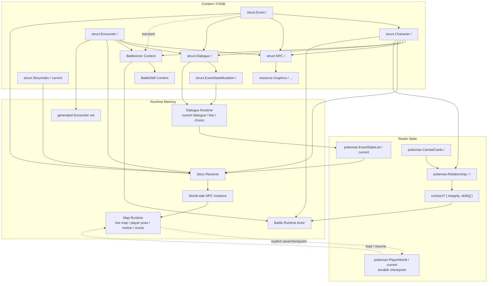

# FSDB identity

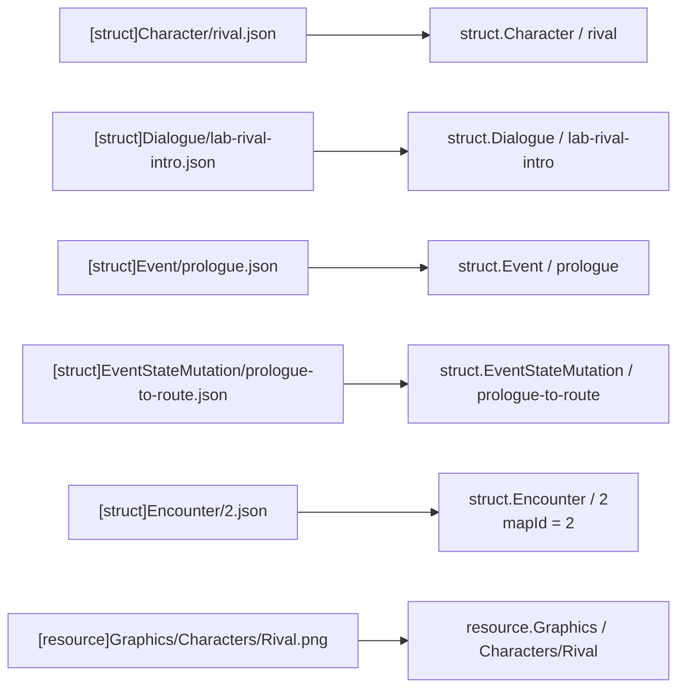

```text
PokeMan struct record key
= definition identity

source value
!= 再保存一份 id
```

固定目标 table 的引用只保存 key；BattleActor 等外部 package serialization namespace 尚未冻结的对象使用 `{namespace,key}` ContentRef。

# Character / NPC / Battle

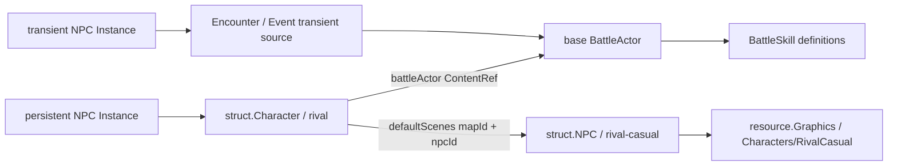

固定：

```text
Persistent NPC Instance
→ Character
→ same base BattleActor

Transient NPC Instance
→ Encounter / Story source
→ base BattleActor
```

不建立 NPC Instance BattleActor variant / resolved Battle profile authority。

# Character default scene / Event takeover

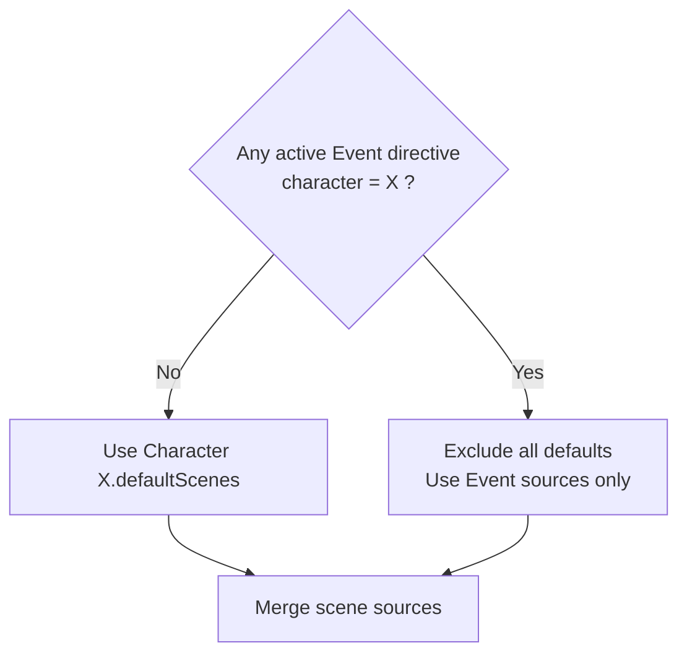

`absent:true` 只表示该 Event 明确提到 Character 但不贡献 placement；它不压制其他 Event placement，也不建立 priority。

# Event FSDB shape

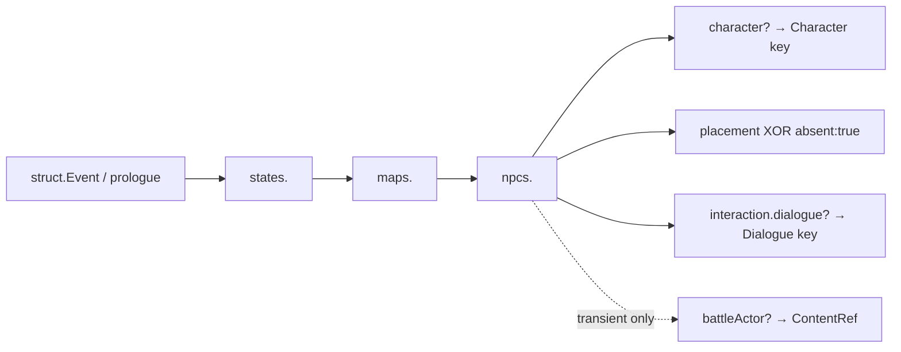

`eventId / stateId / mapId / npcId` 都由 FSDB / object key 表达，不在 value 里重复保存。

# Dialogue

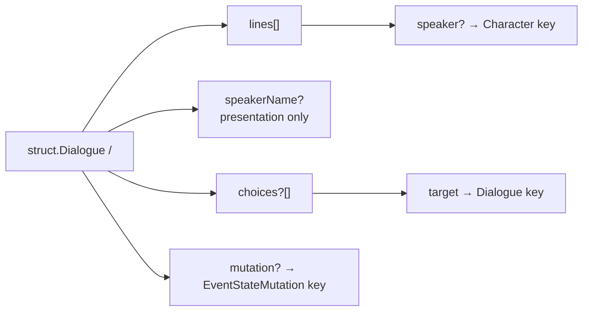

```text
choices XOR mutation
```

# Event state

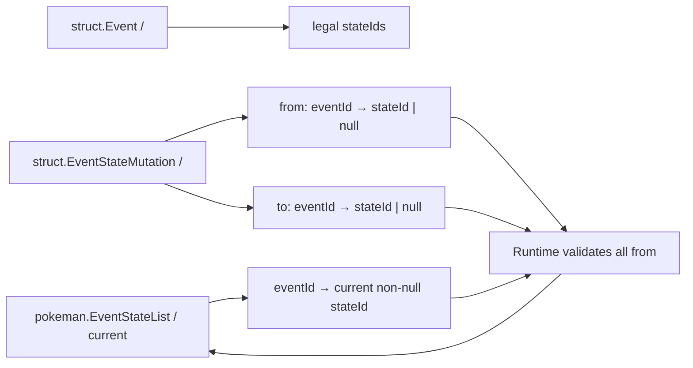

```text
no EventStateList entry
= logical current state null
```

Mutation 只改变 Event current state，不创建 Contract / Card / Battle。

# Relationship / Contract / Card

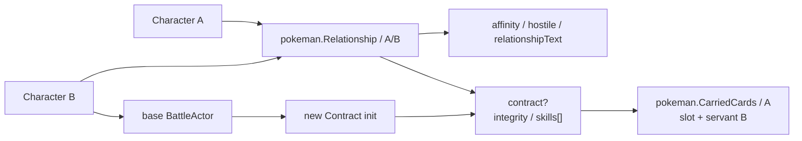

```text
Relationship Record exists
!= Contract exists

Contract exists
!= currently carried
```

Contract initialization：

```text
integrity = BattleActor.max_hp
skills[]  = copy(BattleActor.skills[])
```

MVP 不保存 `maxIntegrity`，也不建立 `cardId`。

# Card Battle

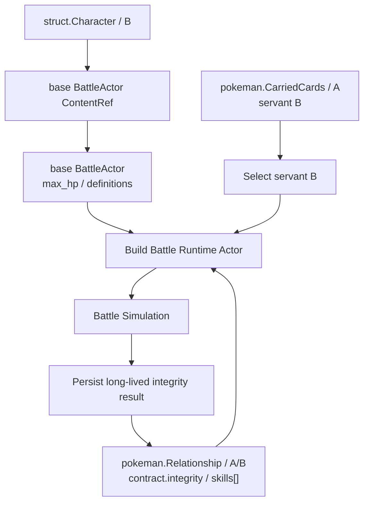

Battle live HP / tile / action / plan 等只属于 Battle Runtime。

# Map live state / durable resume

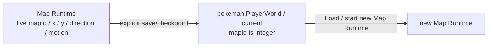

不允许 Map Runtime 与 Realm State 同时成为“当前 live player pose”的 authority。

# Encounter

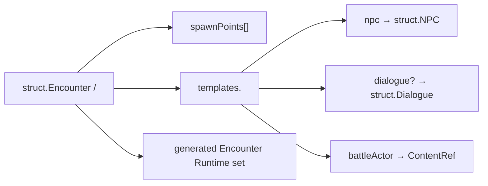

re-entry reroll、defeated persistence、清理时机属于 Runtime/gameplay policy，不在图中建立额外 Realm State authority。

# 一句话总览

```text
Content
= 安装后只读定义；FSDB key 是 PokeMan struct identity

Realm State
= 这一局跨 Subsystem 共享的长期 mutable facts

Runtime Memory
= 当前 Subsystem 正在执行的 live authority / working set
```