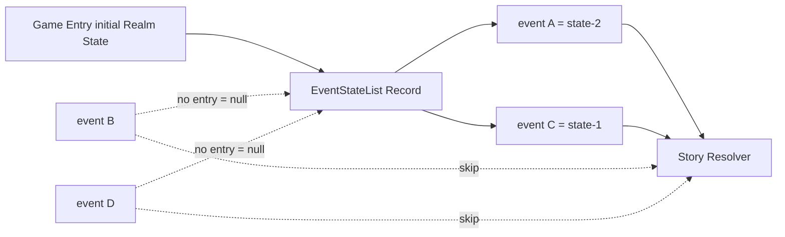
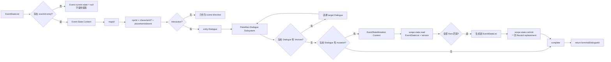
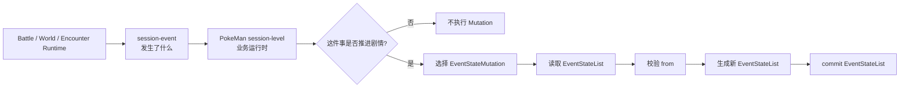
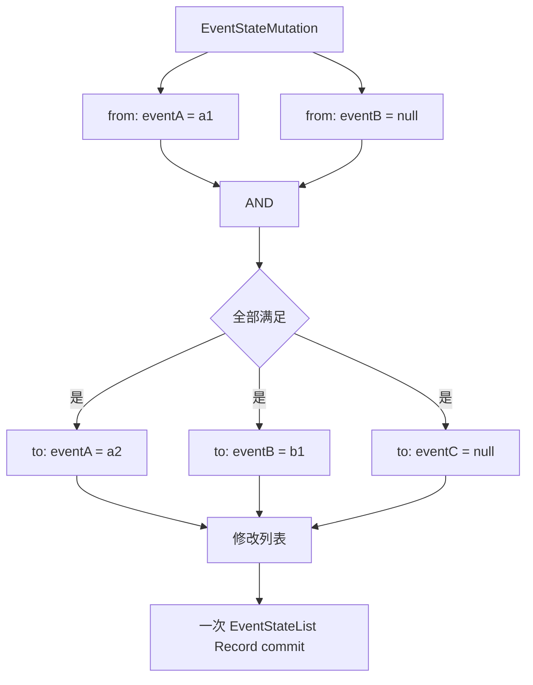
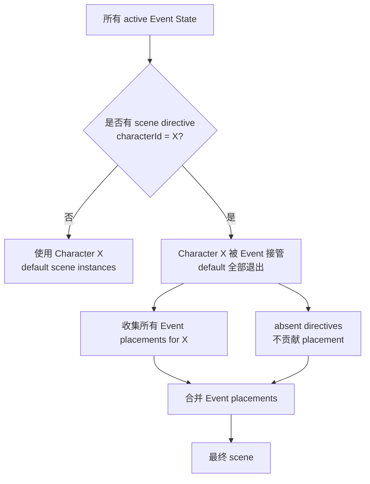
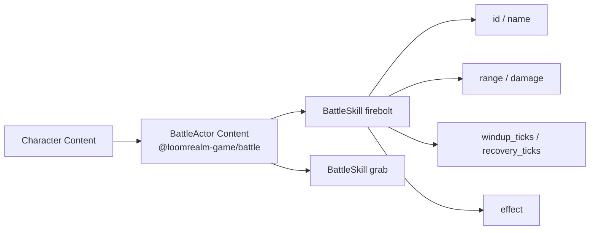

# 数据模型图

> 当前技术数据模型的可视化总览。只画已经确认到当前阶段的职责边界；带“未冻结”的部分不在图里假装成最终 schema。

## UML 总览

```mermaid
classDiagram
    direction LR

    class CharacterDefinition {
      <<Content>>
      id
      name
      description
      fixedAICharacterText
      tags
      defaultSceneInstances[]
      battleActorRef
    }

    class BattleActorContent {
      <<@loomrealm-game/battle Content>>
      id
      name
      characterGraphicsRef
      max_hp
      skills[]
    }

    class BattleSkill {
      <<@loomrealm-game/battle Content>>
      id
      name
      range
      damage
      windup_ticks
      recovery_ticks
      effect
    }

    class VisualDefinition {
      <<Content>>
      id
      mapSprite
      portrait
      battlePresentation
      cardArt
    }

    class NPCDefinition {
      <<Content>>
      npcId
      name
      sprite
    }

    class NPCInstance {
      <<Runtime>>
      instanceId
      npcId
      characterId?
      mapId
      x
      y
      direction
      pattern?
    }

    class Relationship {
      <<RealmState>>
      fromCharacterId
      toCharacterId
      affinity
      hostile
      dynamicRelationshipText
      contract?
      integrity?
      progression?
    }

    class Card {
      <<RealmState>>
      currentCarriedOnly
      holderCharacterId
      servantCharacterId
      slot
    }

    class BattleRuntimeActor {
      <<@loomrealm-game/battle Runtime>>
      actorId
      team
      hp
      maxHp
      tile
      direction
      action
      protectedUntilTickExclusive
      resolvedSkills
      decisionState
    }

    class DialogueDefinition {
      <<Content>>
      id
      lines[]
      choices[]?
      mutationRef?
    }

    class DialogueChoice {
      <<Content>>
      text
      targetDialogueId
    }

    class DialogueCompletion {
      <<Runtime result>>
      terminalDialogueId
    }

    class EventDefinition {
      <<Content>>
      id
      states[]
    }

    class EventState {
      <<Content>>
      stateId
      maps
    }

    class EventStateNPC {
      <<Content>>
      npcId
      characterId?
      placementOrAbsent
      interaction?
    }

    class EventNPCInteraction {
      <<Content>>
      dialogueId
    }

    class EventStateMutation {
      <<Content>>
      from: eventId->stateId|null
      to: eventId->stateId|null
    }

    class EventStateList {
      <<RealmState one Record>>
      entries[]
      entry.eventId
      entry.stateId
    }

    class EncounterDefinition {
      <<Content>>
      spawnPoints
      templates
      battleActorRefs
    }

    class EncounterGeneratedState {
      <<RealmState>>
      persistenceOnlyWhenNeeded
      generatedInstances
    }

    class StoryIndex {
      <<GeneratedContent>>
      byMap
      byCharacter
      byEvent
    }

    CharacterDefinition --> BattleActorContent : battle actor ref
    BattleActorContent --> BattleSkill : skills[]

    NPCDefinition --> VisualDefinition : presentation
    NPCInstance --> NPCDefinition : npcId
    NPCInstance --> CharacterDefinition : optional characterId

    CharacterDefinition "1" <-- "0..*" Relationship : from
    CharacterDefinition "1" <-- "0..*" Relationship : to

    Relationship --> Card : contract + currently carried
    CharacterDefinition "1" <-- "0..*" Card : holder
    CharacterDefinition "1" <-- "0..*" Card : servant

    CharacterDefinition --> DialogueDefinition : speaker refs
    DialogueDefinition "1" *-- "0..*" DialogueChoice : choices
    DialogueChoice --> DialogueDefinition : target
    DialogueDefinition --> EventStateMutation : optional mutation ref
    DialogueDefinition --> DialogueCompletion : returns terminal id

    EventDefinition "1" *-- "1..*" EventState : states
    EventStateList --> EventDefinition : current non-null entries
    EventState "1" *-- "0..*" EventStateNPC : map/npc entries
    EventStateNPC --> CharacterDefinition : optional character takeover
    EventStateNPC --> NPCInstance : placement source
    EventStateNPC "1" *-- "0..1" EventNPCInteraction : interaction
    EventNPCInteraction --> DialogueDefinition : entry dialogue
    EventStateMutation --> EventStateList : validate / replace list

    EncounterDefinition --> NPCInstance : generates
    EncounterDefinition --> BattleActorContent : temporary opponent actor
    EncounterGeneratedState --> NPCInstance : persists generated result

    StoryIndex --> EventDefinition : indexes
    StoryIndex --> CharacterDefinition : indexes

    Card --> BattleRuntimeActor : selects carried contract
    Relationship --> BattleRuntimeActor : integrity / progression
    BattleActorContent --> BattleRuntimeActor : static battle definition
    EncounterDefinition --> BattleRuntimeActor : temporary actor source
```



## EventStateList：一个 Realm State Record



当前物理模型已经确定：

```text
EventStateList
[
  { eventId, stateId },
  ...
]
```

规则：

```text
有 entry
→ current state = entry.stateId

无 entry
→ current state = null
→ Event 当前未启动 / 已清空
```

列表只保存非空 state；不保存 `stateId: null` 项。

```text
null → stateId
= 新增 entry / 启动 Event

stateId → stateId
= 修改 entry / 推进 Event

stateId → null
= 删除 entry / 清空 Event
```

EventStateList 的最终 Realm State namespace / key 名字仍未冻结，但“一张列表 Record”已经冻结。

## Event State / NPC / Dialogue / Mutation 链路



关键边界：

```text
Dialogue Content
= 数据

EventStateMutation Content
= 数据

PokeMan Dialogue Subsystem
= executor
= 解释 Dialogue graph / Mutation
= 通过 scope.state commit EventStateList

@loomrealm-game/rpg-dialogue
= Conversation interaction / presentation
```

`choices` 与 `mutation` 互斥：

```text
choices 存在
=> mutation 不允许存在

mutation 存在
=> choices 不允许存在
```

所以如果某个 Choice 分支需要剧情状态变化：

```text
Choice
→ target Dialogue
→ target Dialogue 无 choices
→ target Dialogue.mutation
→ PokeMan Dialogue Subsystem 执行 EventStateMutation
```

Event State NPC interaction 只保存入口 `dialogueId`。

## 非 Dialogue 业务的 Mutation 路径



这里不要求 Battle / Map / Encounter Content 保存 `mutationRef`：

```text
session-event
= 发生了什么

PokeMan session-level 业务运行时
= 这件事对剧情意味着什么

EventStateMutation
= Event state 怎么改
```

`session-event` 不需要携带 Mutation identity；Mutation 也不拥有 trigger。Runtime 不扫描全部 Mutation 自动触发。

## Mutation 的多 Event / 空状态语义



`from: null` 表示当前列表没有该 Event entry。

`to` 的解释：

```text
to = stateId
→ upsert EventStateList entry

to = null
→ 删除 EventStateList entry
```

Mutation 是“一组 Event state/null 前置条件 → 一组列表变更”，不是一组必须一一配对的 `A → B` 边。

需要 OR 时不在 Mutation 内增加 `or / anyOf`，而是为每个分支定义独立 Mutation，并由具体业务路径选择对应 Mutation。

EventStateMutation 只拥有 Event current state，不修改 Relationship / Contract / Card / Battle / player position 等其他 Realm State。

## Character default fallback / Event takeover



当前规则：

```text
没有 active Event 提到 Character X
→ 才使用 Character default

任一 active Event 提到 Character X
→ default 完全不参与
→ 只看 Event scene directives
```

`absent` 的语义非常窄：

```text
这个 Event 提到了 Character X
但这个 Event 不提供 X 的 placement
```

它不会压制其他 Event 的明确 placement，也不建立 priority / override。

例如：

```text
Event A → rival absent
Event B → rival at town

→ rival default 不参与
→ Event A 无 placement
→ Event B 提供 town
→ 最终 rival at town
```

如果所有提到 X 的 active Event 都没有 placement，则 X 当前不出现。

只有 `npcId`、没有 `characterId` 的 transient / 非 Character NPC source，不会触发 Character default takeover。

## NPC / Event / Map 唯一性

```mermaid
flowchart LR
    L[EventStateList] --> R[Story Resolver]
    CC[Character defaults<br/>unmentioned Characters only] --> R
    EN[Encounter generated NPCs] --> R

    R --> V{validate final Map}
    V -->|每个 mapId 内 npcId 唯一| OK[NPCPlacement[]]
    V -->|同一 mapId 重复 npcId| ERR[deterministic conflict]
```

当前规则：

```text
Source Content
- 不同 Event 可以引用同一个 npcId / Character
- 同一个 Event state 可以让同一个 npcId 出现在多个不同 Map
- absent + peer Event placement 合法

EventStateList
- 只有有 entry 的 Event 参与投影

Character defaults
- 仅对完全未被 active Event 提到的 Character 生效

Final resolved Map
- (mapId,npcId) 必须唯一
```

`instanceId` 继续满足 `@loomrealm-game/map` 的实例 contract，但不能用不同 `instanceId` 绕过 PokeMan 的同图 `npcId` 唯一约束。

## Character / BattleSkill 链路



PokeMan 不增加一层 `PokeManSkill`。BattleSkill 的 shape 和战斗语义由 `@loomrealm-game/battle` 维护；Character 只负责稳定关联 BattleActor Content。

## Relationship / Card / Battle 的关键链路

```mermaid
flowchart LR
    A[Character A] --> R[Relationship A → B]
    B[Character B] --> R

    R --> RS[contract<br/>affinity / hostile<br/>integrity / progression]
    RS --> C{B 当前是否随 A 携带?}

    C -->|否| NC[没有当前 Card<br/>Relationship 长期状态仍存在]
    C -->|是| CARD[Card<br/>holder=A<br/>servant=B<br/>slot]

    B --> BAC[BattleActor Content<br/>max_hp + skills[]]
    BAC --> SK[BattleSkill Content]

    CARD --> BRA[Battle Runtime Actor]
    R --> BRA
    BAC --> BRA

    BRA --> BR[Battle Simulation<br/>hp / tile / direction<br/>action / protection / Decision]
    BR --> R2[Battle 结束<br/>Integrity 回写 Relationship]

    S[Story / Encounter Battle Source] --> TBA[Temporary Battle Runtime Actor]
    BAC --> TBA
    TBA --> BR
```

因此：

```text
Relationship
= 长期人与人 / 契约状态
= affinity / hostile / dynamic text / contract
= integrity / progression / training

Card
= 当前随身状态
= holder / servant / slot

Card absent
≠ Relationship / Integrity / Progression 消失
```

同一个 Character 被不同主公契约时，各自 Relationship 的 Integrity / Progression 相互独立。

## 当前最重要的边界

```text
EventStateList
= 一个 Realm State Record
= 只保存非空 Event state

Character default scene
= 纯 fallback
= 任一 active Event 提到 Character 后整体关闭

absent
= Event 提到 Character，但本 Event 不提供 placement
= 不压制 peer Event placement

Dialogue / Mutation Content
= 数据，不执行

固定 Dialogue Mutation
= Dialogue Content.mutation
→ PokeMan Dialogue Subsystem 执行

非 Dialogue 剧情推进
= session-event 表达业务事实
→ PokeMan session-level 业务运行时选择并执行 Mutation

Relationship
= 长期有向关系 + 契约级长期状态

Card
= 当前随身与 slot

EventStateMutation
= 只改变 EventStateList
= from 全 AND
= null 表示无 entry
= 不拥有 trigger
= 全部 to 通过一次列表 Record replacement 原子提交

BattleActor / BattleSkill Content
= @loomrealm-game/battle 的静态战斗定义

Battle Runtime Actor
= @loomrealm-game/battle 本场 Simulation actor
```

## 图中故意没有解决的数据问题

以下仍然留白：

- Card 是否需要独立 `cardId`；
- Relationship progression / training 的精确 shape；
- Character → BattleActor Content 的最终引用编码；
- 技能学习 / 成长如何改变某个契约长期可用的 `skills[]`；
- Event / EventStateMutation 的最终 Content namespace / key；
- EventStateList Realm State Record 的最终 namespace / key 名字；
- Event placement / `instanceId` / `absent` 的最终 JSON shape；
- transient Encounter NPC 的固定 Dialogue speaker identity；
- Encounter re-entry 与生成结果持久化细节。

BattleSkill 本身的静态字段和执行语义不再作为 PokeMan 自己的未决 schema；它直接跟随 `@loomrealm-game/battle` 当前规范。