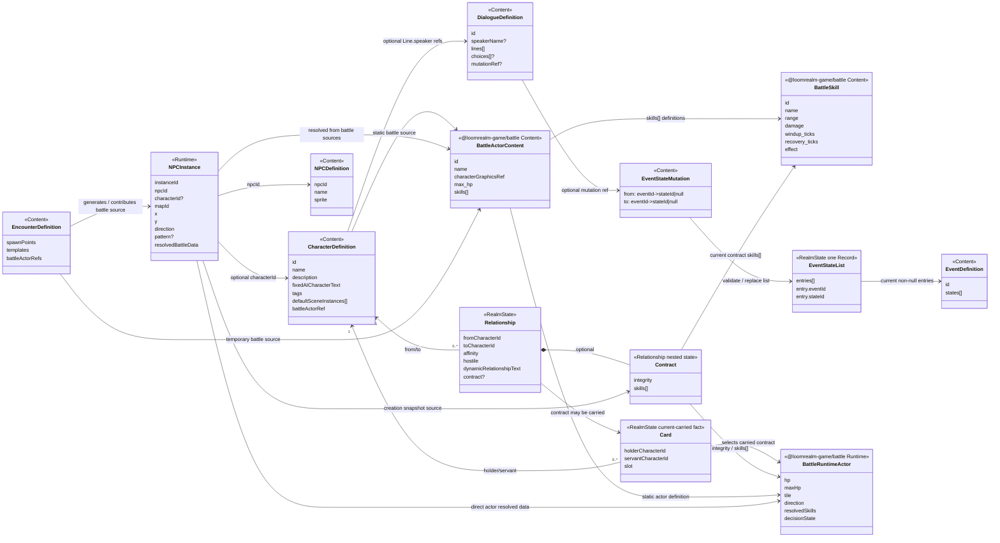
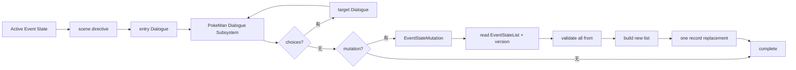
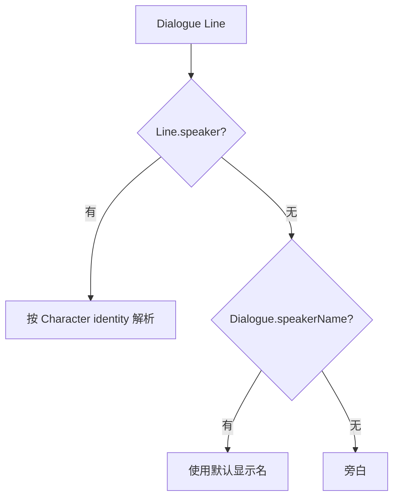
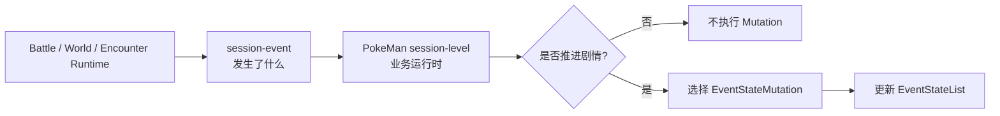
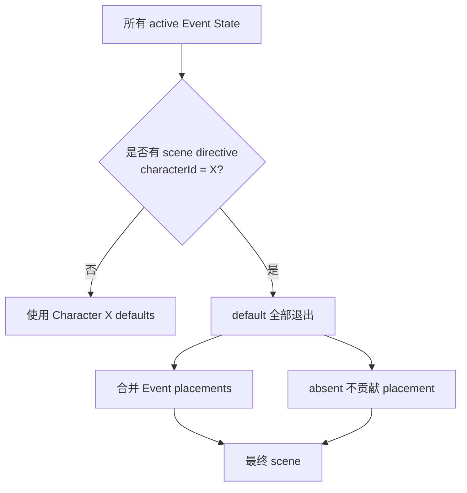

# 数据模型图

> 当前技术数据模型的可视化总览。只画已经确认到当前阶段的职责边界；带“未冻结”的部分不在图里假装成最终 schema。

## UML 总览



`NPCInstance.resolvedBattleData` 在图中表示职责，不冻结最终 JSON 必须真的嵌套一个同名字段。

## NPC Instance → Contract / Battle 链路

```mermaid
flowchart LR
    SRC[Character / Encounter / Story sources] --> NPC[NPC Instance]
    BA[BattleActor Content] --> NPC
    NPC --> RES[resolved battle data<br/>actor/max values + skills[]]

    RES --> DIRECT[本体 / transient actor<br/>本场 Battle 直接使用]
    RES --> INIT[建立新 Contract<br/>snapshot defaults]

    INIT --> CT[Relationship.contract<br/>integrity + skills[]]
    CT --> CARD[Current Card<br/>holder / servant / slot]
    CARD --> BR[Battle Runtime Actor]
    CT --> BR
    BA --> BR

    BR --> OUT[Battle 结束]
    OUT --> CT2[Integrity 写回 contract.integrity]
```

当前规则：

```text
NPC Instance resolved battle data
= Contract 创建时的直接初始化来源
= 本体 / transient actor 的本场 Battle 输入来源

Relationship.contract
= 创建后的长期 authority
= integrity + skills[]

Card
= 只表示当前是否随身 + slot
= MVP 没有独立 cardId / Card identity
```

Contract 创建是 snapshot：

```text
NPC Instance 后续 battle data 变化
≠ 自动改写已有 Contract
```

`contract.integrity` 的初始化来自 NPC Instance resolved battle defaults，而不是该 NPC 某场本体 Battle 的当前剩余 HP。

MVP 不设计：

```text
progression
training state
learnedSkillIds
baseSkills + learnedSkills merge
experience / skill points / skill tree
```

未来真的加入技能学习时，再扩展 Contract 的业务规则。

## EventStateList：一个 Realm State Record

```mermaid
flowchart LR
    I[Game Entry initial Realm State] --> L[EventStateList Record]
    L --> A[event A = state-2]
    L --> C[event C = state-1]
    B[event B] -. no entry = null .-> L
    D[event D] -. no entry = null .-> L
```



```text
有 entry
→ current state = entry.stateId

无 entry
→ current state = null

null → stateId
→ 新增 entry

stateId → stateId
→ 修改 entry

stateId → null
→ 删除 entry
```

EventStateList 的最终 Realm State namespace / key 名字仍未冻结，但“一张列表 Record”已经冻结。

## Event State / Dialogue / Mutation



`choices` 与 `mutation` 互斥。EventStateMutation 只改变 Event current state，不修改 Relationship / Contract / Card / Battle 等其他 State。

## Dialogue speaker 解析



```text
Line.speaker
= 持久 Character identity

Dialogue.speakerName
= transient / non-Character speaker 的默认显示名
= presentation fallback
= 不是 Character identity
```

## 非 Dialogue 业务的 Mutation 路径



Battle / Map / Encounter Content 不保存剧情 `mutationRef`；`session-event` 也不需要携带 Mutation identity。

## Character default fallback / Event takeover



```text
没有 active Event 提到 Character X
→ 才使用 Character default

任一 active Event 提到 Character X
→ default 完全不参与
→ 只看 Event scene directives

absent
= 本 Event 提到 Character，但本 Event 不提供 placement
= 不压制 peer Event placement
```

## NPC / Event / Map 唯一性

```mermaid
flowchart LR
    L[EventStateList] --> R[Story Resolver]
    CC[Character defaults<br/>unmentioned only] --> R
    EN[Encounter Runtime sources] --> R
    R --> V{validate final Map}
    V -->|mapId 内 npcId 唯一| OK[NPCPlacement[]]
    V -->|重复| ERR[deterministic conflict]
```

不同 Event 可以引用同一个 NPC / Character；最终每张 Map 内要求 `(mapId,npcId)` 唯一。

## Encounter persistence 边界

```text
重新进图是否重新 roll
已击败对象是否继续消失
生成结果何时清理
是否跨 Session 保留
```

这些属于 Runtime / gameplay behavior policy，不属于当前数据物理结构缺口。

当前不预设：

```text
EncounterGeneratedState
generatedInstances[]
defeatedIds[]
spawn snapshot
seed Record
```

只有未来 Runtime policy 确实要求某些事实跨边界持续时，才根据最小需求增加 Realm State。

## 当前最重要的边界

```text
Relationship
= 有向长期关系

Relationship.contract
= 可选长期契约状态
= MVP: integrity + skills[]

NPC Instance resolved battle data
= Contract 创建时的直接默认值来源
= direct actor 的本场 Battle 输入来源

Card
= 当前随身与 slot
= 无独立 cardId / identity

EventStateList
= 一个 Realm State Record
= 只保存非空 Event state

Dialogue.speakerName
= 默认显示名
= 不是 Character identity

固定 Dialogue Mutation
= Dialogue Content.mutation
→ Dialogue Subsystem 执行

非 Dialogue 剧情推进
= session-event
→ session-level 业务运行时选择 Mutation

Encounter re-entry / persistence
= Runtime/gameplay policy
= 当前不预设 State shape
```

## 图中故意没有解决的数据问题

以下仍然留白：

- Relationship / Contract 的最终 Realm State key / JSON shape；
- Card 的最终 Realm State 物理布局与必要唯一约束；不设计独立 `cardId`；
- **NPC Instance battle source / resolved battle data 的最终引用与 schema**，包括 Character / Encounter / Story 如何解析到 BattleActor，以及 Contract 初始化默认字段如何表达；
- Character → BattleActor Content 的最终引用编码；
- Event / EventStateMutation 的最终 Content namespace / key；
- EventStateList Realm State Record 的最终 namespace / key；
- Event placement / `instanceId` / `absent` 的最终 JSON shape。

以下不再作为 MVP 数据模型缺口：

```text
Card identity / cardId
Contract 默认值来源
Encounter re-entry / persistence
progression / training shape
技能成长 / base+learned merge
transient Encounter speaker identity
非 Dialogue Content mutationRef
```

Encounter re-entry / persistence 属于 Runtime/gameplay policy，不应在当前阶段反推一个猜测性的 Encounter State shape。

BattleSkill 本身的静态字段和执行语义直接跟随 `@loomrealm-game/battle` 当前规范。