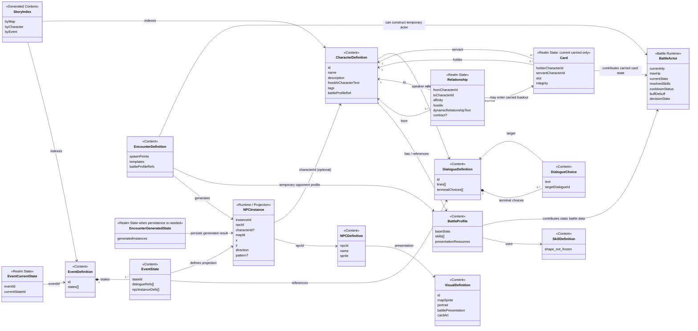
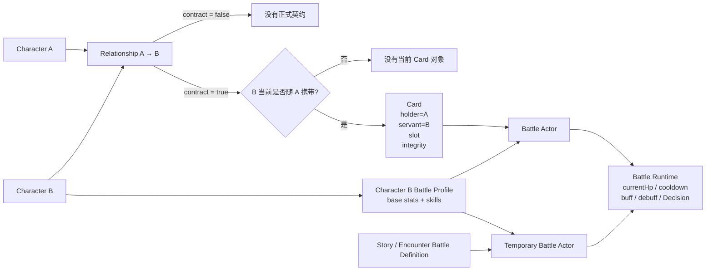

# 数据模型图

> 当前技术数据模型的可视化总览。只画已经确认到当前阶段的职责边界；带“未冻结”的部分不在图里假装成最终 schema。

## UML 总览



## Relationship / Card / Battle 的关键链路



## 当前最重要的边界

```text
Relationship
= 长期人与人关系
= affinity / hostile / dynamic text / contract

Card
= 当前随身 Card
= holder / servant / slot / 当前 Card battle-facing state

Battle Actor
= 本场临时战斗实体
= HP / cooldown / Buff / Debuff / Decision
```

因此：

```text
contract exists
≠ Card 一定存在

Card exists
=> 对应 contract 已成立，并且当前进入随身编队

Battle Actor exists
≠ 必须来自 Card
```

剧情 / Encounter 可以直接构造临时 Battle Actor，不需要伪造 Relationship 或 Card。

## 图中故意没有解决的问题

以下仍然留白：

- Card 是否需要独立 `cardId`；
- 从者有 contract 但不随身时，Integrity / Progression 长期状态最终由谁拥有；
- Skill 的最终字段、执行模型、学习 / 成长方式；
- Event 的完整 flow / trigger；
- Encounter re-entry 与生成结果持久化细节。

这些问题继续设计后再补图。